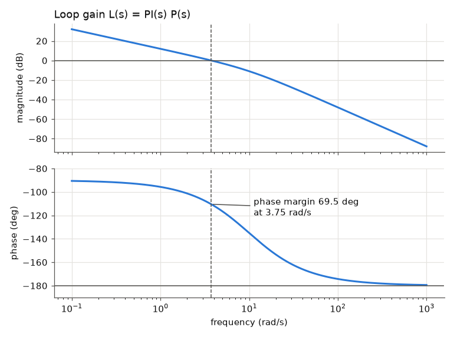
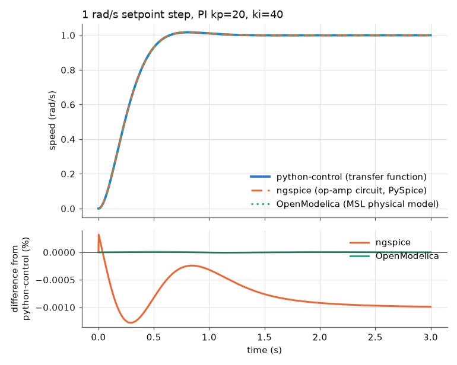
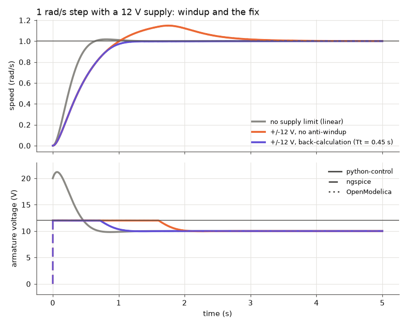

# motor-control-three-ways

[](https://github.com/builtbyshailendra/motor-control-three-ways/actions/workflows/ci.yml)

> Personal learning project, built pairing with Claude Code.

One DC-motor speed loop, simulated three independent ways and checked against each other: as transfer functions in **python-control**, as an op-amp circuit in **ngspice** (netlist built and run through **PySpice**), and as a physical model in **OpenModelica** (Modelica Standard Library). Then a 12 V supply limit, the integrator windup it causes, and the anti-windup fix, seen by all of them plus python-control's nonlinear I/O systems.

Built 26 Nov 2026. The motor is a textbook example, not a real part; there is no hardware. ngspice and OpenModelica ran only in GitHub Actions (Ubuntu 24.04), never on the Windows laptop this was written on. Every number below comes from the files in `results/`, written by CI run 45820217003 (commit 53fa84a); step 1 and the python-control parts of step 4 also ran locally with the same numbers.

```text
setpoint ─►(+)─ e ─► PI ─ v ─► [supply limit] ─ u ─► motor ─► speed w
            ▲(-)                                              │
            └──────────────────────────────────────────────────┘
python-control   transfer functions; nlsys + interconnect for the limit
ngspice          motor as an electrical analog (J = 1 F, 1/b = 10 ohm, K*i = a current source)
                 PI as op-amp stages: difference amp, RC integrator, P amp, summer
OpenModelica     Resistor, Inductor, RotationalEMF, Inertia, Damper; PI / Limiter / LimPID
```

## Run it

```bash
pip install -r requirements.txt   # control 0.10.2, numpy 2.5.5, scipy 1.18.1, matplotlib 3.11.2, PySpice 1.5, pytest 9.2.0
python -m pytest                  # locally: 16 pass, 13 skip (they need ngspice or omc)
python scripts/run_all.py         # writes results/; locally only steps 1 and 4 (python-control part)
```

ngspice and OpenModelica tests skip when the tool is missing. In CI they must run: `MCT_REQUIRE_TOOLS=1` turns a missing tool into a failure, so a broken install can't hide behind a green run. CI (`.github/workflows/ci.yml`, about 2 minutes a run):
- `apt-get install ngspice libngspice0` (Ubuntu's ngspice 42) and `NGSPICE_LIBRARY_PATH=/usr/lib/x86_64-linux-gnu/libngspice.so.0` for PySpice;
- `omc` from the official image `openmodelica/openmodelica:v1.27.1-minimal`, through a wrapper script on the PATH that runs `docker run ... omc "$@"` with the workspace mounted at the same path;
- `omc modelica/install_msl.mos` installs the Modelica Standard Library 4.1.0 (the minimal image has none);
- `pytest` (29 tests, 19 s), `scripts/run_all.py`, and the results uploaded as an artifact.

To run the CI-only parts yourself: push a branch (every push runs CI), `gh run watch`, then `gh run view --log` or `gh run download <id> -n results`. On a machine with ngspice: `cd netlists && ngspice -b linear.cir` writes `linear.txt`. With OpenModelica: `mkdir -p build/modelica && cd build/modelica && omc ../../modelica/simulate.mos`.

## The motor and the specs

From "Control Tutorials for MATLAB and Simulink" (University of Michigan, Carnegie Mellon, Detroit Mercy), [DC Motor Speed: System Modeling](https://ctms.engin.umich.edu/CTMS/index.php?example=MotorSpeed&section=SystemModeling): J = 0.01 kg·m², b = 0.1 N·m·s, K = 0.01 N·m/A (= V·s/rad), R = 1 Ω, L = 0.5 H. The same tutorial's PID page sets the specs: settling under 2 s, overshoot under 5 %, steady-state error under 1 %.

    J dw/dt = K i - b w        L di/dt = v - R i - K w        W(s)/V(s) = K / ((J s + b)(L s + R) + K²)

It is a weak motor: 1 rad/s needs 10.01 V.

## How the numbers are measured

Every tool's waveform is linearly interpolated onto the same 1 ms grid (0 to 3 s, or 0 to 5 s for windup). Agreement is the largest |difference| from python-control on that grid, in % of the 1 rad/s setpoint. Step metrics (overshoot, 2 % settling time, 10–90 % rise) come from python-control's `step_info` applied to each waveform, so every tool is measured by the same code.

## Step 1: plant and PI design in python-control

`mct/design.py`, `results/step1_design.txt`.
- **Open loop:** poles at −2.0025 and −9.9975 rad/s (time constants 499 ms and 100 ms); DC gain 0.0999 rad/s per V; a 1 V step settles in 2.056 s.
- **PI design:** put the PI zero on the slow motor pole (ki/kp = 2), which leaves a loop of about 2kp / (s(s + 10)); kp = 20 gives damping 0.79. **kp = 20 V per rad/s, ki = 40 V per rad** (Ti = 0.5 s).
- **Closed loop, 1 rad/s step:** overshoot **1.71 %**, settling **0.583 s**, rise 0.384 s, error at 3 s 0.0003 % (the integrator drives it to zero). All three specs met.
- **Margins:** gain margin infinite (the phase never reaches −180°), phase margin **69.49° at 3.746 rad/s**. A test recomputes the phase margin from the formula with numpy and scipy's `brentq`: same answer within 0.05°.
- **Discretised** (PI by Tustin, plant by zero-order hold):

| Sample time | PI(z) numerator | Max diff from continuous | Overshoot | Gain margin | Phase margin |
|---|---|---|---|---|---|
| 1 ms | 20.020 z − 19.980 | 0.093 % | 1.74 % | 54.0 dB | 69.38° |
| 10 ms | 20.200 z − 19.800 | 0.940 % | 2.11 % | 34.2 dB | 68.42° |
| 50 ms | 21.000 z − 19.000 | 4.835 % | 4.30 % | 20.9 dB | 64.24° |
| 100 ms | 22.000 z − 18.000 | 10.067 % | 8.06 % | 15.9 dB | 59.26° |

At 1 kHz the discrete loop is the continuous one to within 0.1 %. Sampling makes the gain margin finite (the hold adds delay), and at 10 Hz the overshoot breaks the 5 % spec. python-control warns that it falls back to a frequency sweep for the discrete margins; a test checks the gain margin and crossover against an independent sweep of L(e^jωT) (within 0.1 %).



## Step 2: the same loop as an op-amp circuit in ngspice (PySpice)

`mct/circuit.py` builds the circuit with PySpice; `netlists/*.cir` are the generated decks (a test checks they match the generator). Mechanical side as its electrical analog: speed is the voltage of node `w` (1 V = 1 rad/s), torque K·i is a current-controlled current source into that node, inertia J is a 0.01 F capacitor, friction b is a 10 Ω resistor. The armature is R and L plus a back-EMF source E = K·w; a 0 V source measures the current. The controller: a tachometer buffer, a difference amplifier (e = r − w), an inverting integrator (Ri = 10 kΩ, Ci = 2.5 µF, so RiCi = 25 ms = 1/ki), an inverting P amplifier (200 kΩ / 10 kΩ = kp), and an inverting summer. Op-amps are ideal: a voltage-controlled voltage source with gain 10⁶. 25 elements.

`results/step2_spice.txt`:
- **Against python-control: max error 0.0013 % of the setpoint** (at 0.291 s), at 3 s 0.00099 %. Overshoot 1.707 %, settling 0.583 s, rise 0.384 s, the same as python-control to the millisecond.
- The same deck run two ways, through PySpice's shared library (3,035 time points, 0.07 s) and as `ngspice -b` with a `.control` block writing `wrdata` (0.03 s): identical to 5×10⁻¹¹ %. Both printed `Using SPARSE 1.3 as Direct Linear Solver`.
- **What limits the agreement is the op-amp, not the solver.** An inverting integrator built from an op-amp with open-loop gain A has DC gain A, not infinity, so the loop settles where A·e equals the 10.01 V the motor needs:

| Op-amp gain A | reltol | Max error | Error at 3 s | Predicted 10.01 V / A |
|---|---|---|---|---|
| 10³ | 10⁻⁴ | **1.08 %** (fails the 1 % check) | 0.969 % | 1.001 % |
| 10⁴ | 10⁻⁴ | 0.109 % | 0.0988 % | 0.100 % |
| 10⁵ | 10⁻⁴ | 0.0111 % | 0.0099 % | 0.0100 % |
| 10⁶ | 10⁻⁴ | 0.0013 % | 0.00099 % | 0.00100 % |
| 10⁸ | 10⁻⁴ | 0.0003 % | 0.00001 % | 0.00001 % |
| 10⁶ | 10⁻³ (default) or 10⁻⁶ | 0.0013 % | 0.00099 % | |

A test checks the 10.01 V / A rule at A = 10⁴ and 10⁶ (within 10 %).

## Step 3: the same loop as a physical model in OpenModelica

`modelica/MotorControl.mo`: `Motor` connects `SignalVoltage`, `Resistor`, `Inductor`, `RotationalEMF`, `Inertia`, `Damper` (to a `Fixed` flange) and `SpeedSensor`; `SpeedLoop` closes it with `Step`, `Feedback` and `Blocks.Continuous.PI` (k = 20, T = 0.5 s). `modelica/simulate.mos` runs every model with omc (DASSL, tolerance 10⁻⁸, 3,000 output intervals) and writes CSVs.

`results/step3_modelica.txt`:
- **Against python-control: max error 0.00001 % of the setpoint.** Overshoot 1.707 %, settling 0.583 s, rise 0.384 s. The armature voltage (the PI block's output) matches kp·e + ki·∫e computed from python-control's speed to 0.00009 % of 10 V.
- Solver tolerance against agreement: 10⁻⁴ gives 0.0157 %, omc's default 10⁻⁶ gives 0.00023 %, 10⁻⁸ gives 0.00001 %.
- omc time per model in CI: 1.36–1.41 s to generate and compile C, 0.019–0.024 s to simulate.



## Step 4: the supply limit, integrator windup, and the fix

python-control's transfer functions are linear: the PI's output can be any number of volts, and the step above asks for 20 V at t = 0 and up to 21.18 V while the integrator fills. A real supply gives 12 V. The linear model can't see that, so `mct/nonlinear.py` makes the PI an `nlsys` with a clipped output and connects it to the motor with `interconnect` (a fourth model). Without a limit it matches the transfer function to 2×10⁻¹⁴ rad/s (local run; the test asserts 10⁻⁶).

- **ngspice:** the power stage becomes a B source, `V = min(max(V(v),-12),12)`.
- **OpenModelica:** `SpeedLoopSaturated` puts a `Limiter` after the PI.
- **The fix, back-calculation anti-windup:** dI/dt = ki·e + (u − v)/Tt, where v is what the PI asks for and u what the supply gives. Tt = 0.45 s, which is Modelica `LimPID`'s default (Ni = 0.9 times Ti). In the circuit, an ideal difference amplifier makes u − v and a 180 kΩ resistor feeds it into the integrator's summing node (Rt·Ci = 0.45 s). In Modelica, `SpeedLoopAntiWindup` is a `LimPID` with `controllerType = PI`, `yMax = 12`.

`results/step4_windup.txt`, 1 rad/s step, 5 s:

| | Overshoot | Settling (2 %) | Peak | Agreement with python-control nonlinear |
|---|---|---|---|---|
| no limit (linear) | 1.71 % | 0.583 s | 0.811 s | |
| ±12 V, no anti-windup, python-control | **14.86 %** | **2.909 s** | 1.749 s | |
| ±12 V, no anti-windup, ngspice | 14.86 % | 2.908 s | 1.749 s | 0.0030 % |
| ±12 V, no anti-windup, OpenModelica | 14.86 % | 2.909 s | 1.749 s | 0.000007 % |
| ±12 V, back-calculation, python-control | **0.00 %** | **1.047 s** | rises monotonically | |
| ±12 V, back-calculation, ngspice | 0.00 % | 1.047 s | | 0.0011 % |
| ±12 V, back-calculation, OpenModelica (LimPID) | 0.00 % | 1.047 s | | 0.000005 % |
| ±12 V, LimPID with Ni = 10⁹ (tracking off), OpenModelica | 14.86 % | 2.909 s | 1.749 s | 0.000007 % |

Windup multiplies the overshoot by 8.7 and the settling time by 5; the fix removes the overshoot and settles in 1.05 s. The last row checks that LimPID with its tracking switched off winds up exactly like PI + Limiter, so the difference really is the tracking term.

**Choosing Tt** (python-control nonlinear model): faster tracking is not better.

| Tt | 0.05 s | 0.1 s | 0.25 s | 0.45 s | 1 s | 2 s | none |
|---|---|---|---|---|---|---|---|
| Overshoot | 0 % | 0 % | 0 % | 0 % | 5.57 % | 9.66 % | 14.86 % |
| Settling | 1.895 s | 1.850 s | 1.605 s | **1.047 s** | 1.916 s | 2.338 s | 2.909 s |

With a very short Tt the integrator is held almost empty while the supply is saturated, so the speed creeps the last few percent on the slow motor pole.



(In the voltage plot the dashed ngspice line starts at 0 V because its setpoint source rises over 1 µs from 0 at t = 0.)

## Results

| | Measured | How |
|---|---|---|
| PI design | kp = 20, ki = 40: overshoot 1.71 %, settling 0.583 s, rise 0.384 s | python-control `step_info` on a 1 ms grid |
| Margins | gain margin infinite, phase margin 69.49° at 3.746 rad/s; at 1 kHz sampling 54.0 dB and 69.38° | `control.margin`, checked by an independent sweep |
| ngspice vs python-control | 0.0013 % max (op-amp gain 10⁶) | max \|difference\| on the 1 ms grid, % of setpoint |
| OpenModelica vs python-control | 0.00001 % max (tolerance 10⁻⁸) | same |
| PySpice vs `ngspice -b`, same deck | 5×10⁻¹¹ % | same |
| Windup, ±12 V | overshoot 1.71 % → 14.86 %, settling 0.583 → 2.909 s | all four tools within 0.003 % of each other |
| Anti-windup, Tt = 0.45 s | overshoot 0 %, settling 1.047 s | same |
| Tests | 29 in CI (16 run locally, 13 need ngspice or omc) | pytest 9.2 |

## What broke, and what I learned

1. **PySpice 1.5 with ngspice 42 raised `NgSpiceCommandError: Command 'run' failed` after a successful run** (first CI run, 4 tests). ngspice prints `Using SPARSE 1.3 as Direct Linear Solver` on stderr, and PySpice treats every stderr line not starting with `Warning:` as an error. `mct/spice.py` subclasses `NgSpiceShared` and tolerates exactly that line; any other stderr still fails. PySpice also logs `Unsupported Ngspice version 42` and falls back to its newest vector-type table; the results agree with `ngspice -b`, so that fallback is fine here.
2. **PySpice asks for `libngspice.so`, Ubuntu's runtime package ships only `libngspice.so.0`** (seen in the CI log). CI sets `NGSPICE_LIBRARY_PATH` to the `.so.0` instead of installing the `-dev` package. I set this up front after reading PySpice's loader; I didn't try without it.
3. **On Windows, PySpice writes netlists with CRLF line endings and no `.end`.** The generator normalises to LF and adds the batch commands itself, so the committed netlists are the same on every OS.
4. **The minimal OpenModelica image has no Modelica Standard Library.** `loadModel(Modelica, {"4.1.0"})` returned false; `installPackage(Modelica, "4.1.0")` installs it in about 6 s per CI run, so no cache was needed.
5. **python-control's `step_info` on a system object reported a 0.604 s settling time; on the 1 ms grid it is 0.583 s.** Given a system, `step_info` picks its own time grid, and settling is the first grid point after the last band crossing. All tools are now measured on the same grid with the same function.
6. **The ngspice loop settled 0.00099 % low.** Not the solver: reltol from 10⁻³ to 10⁻⁶ changed nothing. It is 10.01 V divided by the op-amp gain (see step 2); with A = 1000 the circuit fails the 1 % check.
7. **Faster anti-windup tracking made settling worse** (Tt = 0.05 s: 1.895 s against 1.047 s at 0.45 s).
8. **Op-amp rails broke ngspice** (an experiment while writing the exercises, not in the committed circuit; dev-branch CI runs 45818725645 and 45819130464, script not kept). Giving every ideal op-amp a ±15 V hard limit at gain 10⁶ stopped the transient at t = 1.034 s with `Timestep too small ... trouble with node "u4n"` (the summer). `method=gear` and a smooth `tanh` limit failed the same way; at gain 10⁴ it ran, and the rails cut the windup overshoot from 14.86 % to 12.44 %, because the integrator op-amp can't wind beyond its rail. A sharp limit times a huge gain is a corner Newton's method can't get round.

## Limits

- One textbook motor and one PI design. No real hardware, no measured data.
- Op-amps are ideal voltage-controlled sources with gain 10⁶: no gain-bandwidth limit, slew rate, offset or rails in the committed circuit (LEARN.md exercise 3 adds them).
- Motor model is linear: no Coulomb friction, no current limit, no PWM or H-bridge, no sensor noise or encoder quantisation.
- The discrete controller is analysed in python-control only; ngspice and Modelica simulate the continuous PI.
- The PI zero cancels the slow motor pole, so a load torque is rejected on that slow pole (about 0.5 s); there is no load in the committed models (LEARN.md exercise 4 adds one).
- The tools agree because they solve the same equations. That checks the tools and my modelling of the loop, not the physics of a real motor.
- ngspice and OpenModelica ran only in CI (Ubuntu 24.04, ngspice 42, OpenModelica 1.27.1, MSL 4.1.0).

## Layout

| Path | What's in it |
|---|---|
| `mct/params.py` | motor, controller, supply, step, Tt (with the CTMS citation) |
| `mct/design.py` | step 1: plant, PI, margins, metrics, discretisation (python-control) |
| `mct/circuit.py` | step 2: the circuit built with PySpice; batch decks for `ngspice -b` |
| `mct/spice.py` | running ngspice through PySpice's shared library or `ngspice -b` |
| `mct/modelica.py` | step 3: running `simulate.mos` with omc, reading the CSVs |
| `mct/nonlinear.py` | step 4: saturated PI as a python-control `nlsys`, `interconnect` |
| `mct/compare.py`, `mct/report.py` | interpolation and error metrics; results files and plot style |
| `modelica/MotorControl.mo` | the Modelica package: `Motor`, `SpeedLoop`, `SpeedLoopSaturated`, `SpeedLoopAntiWindup`, `SpeedLoopLimPIDNoTracking` |
| `modelica/simulate.mos`, `modelica/install_msl.mos` | omc scripts |
| `netlists/` | generated decks: `linear.cir`, `saturated.cir`, `antiwindup.cir` |
| `tests/` | 24 test functions, 29 cases; `_tools.py` has the skip markers |
| `scripts/` | one script per step, `run_all.py` runs them in order |
| `results/` | the output of CI run 45820217003: four text summaries, three plots |
| `LEARN.md` | each tool's concepts, questions to explain without notes, one exercise per tool |
